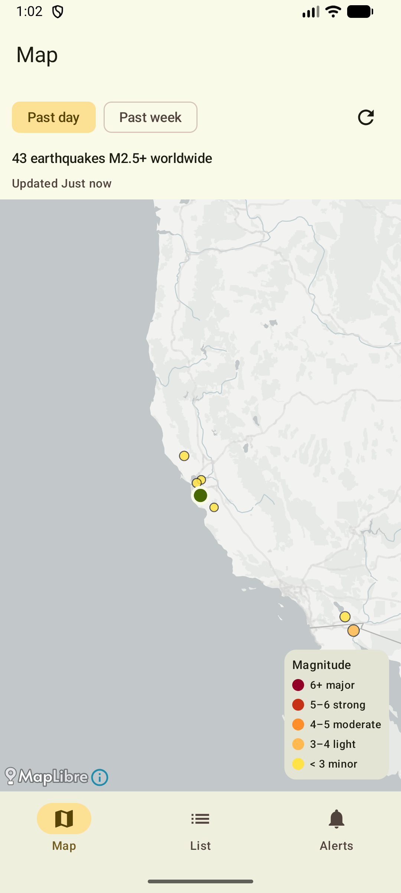
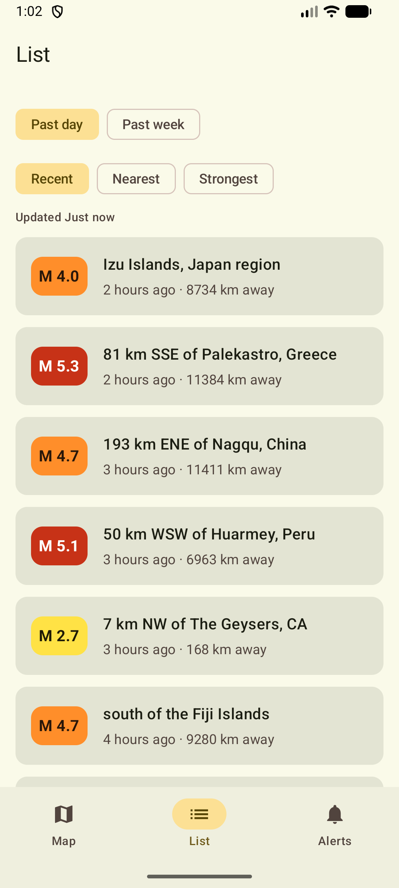
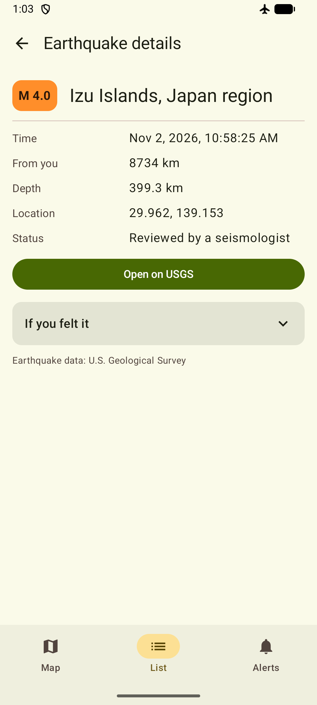
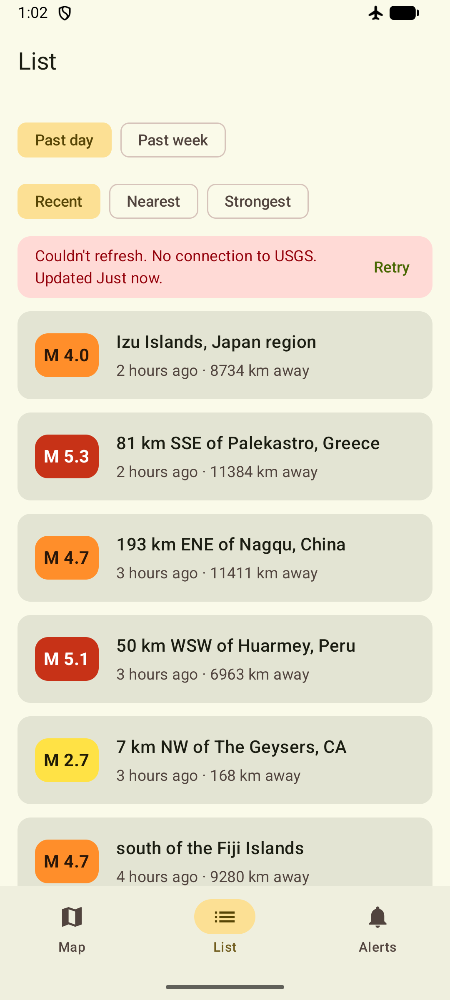
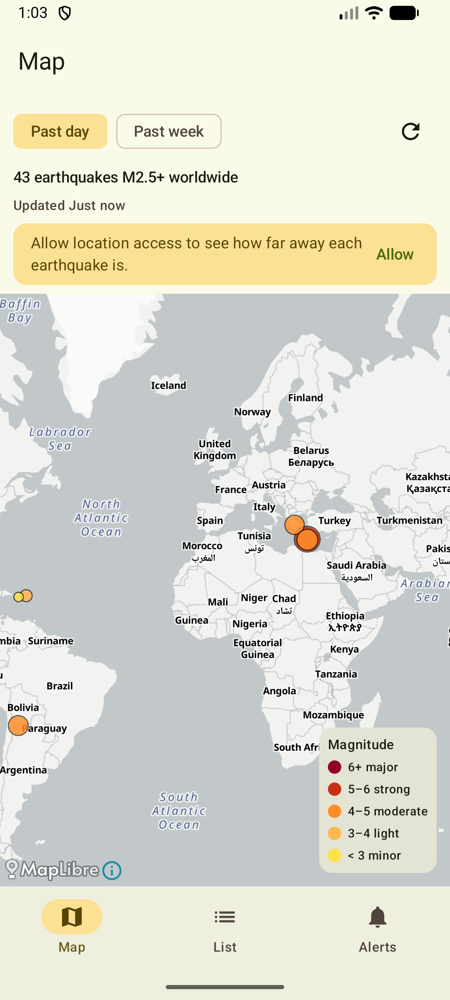

# Grounded

An Android app (Kotlin, Jetpack Compose) that shows recent earthquakes and how far away they are. Data comes from the [USGS real-time feeds](https://earthquake.usgs.gov/earthquakes/feed/).

| Map                              | List                               | Details                                 | Offline                                  | No location                                      |
|----------------------------------|------------------------------------|-----------------------------------------|------------------------------------------|--------------------------------------------------|
|  |  |  |  |  |

## Approach

* ~20-30 minutes: Read through prompt and brief research of what earthquake apps usually contain
* ~30 minutes: Set up the projects with dependency decisions and skeleton and code organization practices (+ CLAUDE.md)
* ~2.5 hours: Working with Claude to implement, debug, and create features/functionality
* ~1.5 hour: Reviewing the code and capturing any documentation 
* ~1 hour: When things never go according to plan

## Features

- **Map:** M2.5+ earthquakes worldwide for the past day or week, colored by magnitude, with a legend and your location. Tap a circle to see a summary, then open the details.
- **List:** the same earthquakes, sorted by Recent, Nearest or Strongest, with pull-to-refresh. Rows show magnitude, place, time, distance, and PAGER and tsunami chips when they apply.
- **Details:** local time, distance, depth, coordinates, review status, felt reports, PAGER level, a link to USGS, and a short "If you felt it" safety section.
- **Alerts:** optional notifications for earthquakes near you (M2.5–5.5+, 50–500 km). The app checks every 2 minutes while it's open and about every 15 minutes in the background. Alerts are informational, not an early warning.
- **Offline:** the last download is cached. The app shows it with "Couldn't refresh · Updated …", and details still open.
- **Without location:** everything still works. Distances, your marker and the Nearest sort are hidden, and a banner offers Allow or Settings.

## Build and run

You need JDK 17+ and an emulator or device running **Android 14 (API 34)+**. There are no API keys: USGS and the OpenFreeMap tiles are free.

```bash
./gradlew installDebug                 # build and install
./gradlew testDebugUnitTest            # JVM unit tests
./gradlew connectedDebugAndroidTest    # Compose UI tests (device/emulator)
./gradlew lint
./gradlew ktlintCheck                  # Kotlin style; ktlintFormat fixes most issues
```

On an emulator, set a location in *Extended controls → Location* to see distances.

## Architecture

MVVM with unidirectional data flow: each screen is a stateless Composable that renders one `StateFlow<UiState>` and sends events back up.

| Package  | Contents                                                                          |
|----------|-----------------------------------------------------------------------------------|
| `ui`     | Map, List, Alerts and Detail (screens, ViewModels, UiState), navigation, theme    |
| `data`   | repositories, USGS remote (Retrofit + kotlinx.serialization), location, DataStore |
| `domain` | pure Kotlin: GeoPoint (haversine), Severity, TimePeriod, AlertRules, DataError    |
| `alerts` | foreground poller, background worker, shared alert rules, notifications           |
| `core`   | logging, analytics, app foreground state, coroutine helpers                       |
| `di`     | Hilt modules                                                                      |

**Stack:** Compose + Material 3, Navigation 3, Hilt, MapLibre (OpenFreeMap tiles), Retrofit/OkHttp, DataStore, WorkManager, Timber. Ktlint

#### Main Architectural Considerations

* **Unilateral data flow**: Domain models travels from the repository to be manipulated by the ViewModel to ummutable UIState models. Events are sent back to the ViewModel that could sent a new UIState model.
* **Abstraction**: Layers are exposed through Interfaces that provide only the information needed by the consumers. By abstracting out the implementation, developers could also easily swap to different services as needed without breaking contract. (ie switching logging to datadog vs splunk vs etc)
* **Analytics/Logging**: Should be considered as part of initial feature discussions. These help drive and prove "did our feature succeed?" conversations with stakeholders through data driven results
* **Layer Responsibility**: Each layer/class should have a strong responsibility of what it owns. Business logic should be kept out of UI layers. Navigation is large enough to be managed independently. Each class should leverage DI to easily add/remove resources as needed. 

### Key decisions

- **One cached feed is the single source of truth.** Map, List, Details and alerts all observe `EarthquakeRepository.feed(period)`. The selected period is one saved preference, so Map and List always match. The feed is stored as JSON in DataStore; Room would be overkill for two small lists.
- **Failures never wipe data.** A failed refresh keeps the cache and reports a typed `DataError`. A full-screen error shows only when nothing has been cached yet.
- **Coarse device location via `LocationManager`.** There's no Play Services dependency. The last fix is saved on the device (excluded from backup) for background alerts and cleared if the permission is revoked.
- **Nearby is computed on the device** from the worldwide summary feeds (`2.5_day`, `2.5_week`), which USGS asks apps to use for display.
- **Alerts:** a foreground poller and a WorkManager job share one set of rules. There's no background location permission, so background checks use the last fix from when the app was open. Alert state is persisted, because a worker usually runs in a fresh process.
- **Map:** MapLibre sits behind a thin `QuakeMap` slot, so UI tests can substitute a fake. One `MapView` is kept across tab switches. Screen-reader users are pointed to the List tab.

## Tradeoffs

- **M2.5+, past day or week only.** Smaller events are mostly noise, and a month of events would need marker clustering.
- **Background alerts are best effort.** Doze can delay them by hours, and timely alerts would need server push, which USGS doesn't offer.
- **Background distances use the last foreground location.** If you travel without opening the app, alerts are measured from your old location.
- **minSdk 34** keeps platform APIs simple. It could likely drop to 30. 34 was based on most common Android SDK in the USA.

## Next steps 

- Building out more build flavors/types to support multiple environments and proguard/R8 rules
- Define a component library/theme with reusable Composables to have a more consistent branding & faster UI development
- Support for light/dark, landscape vs portrait
- Run performance testing with the notifications and data polling
- Flush out the permissions prompting. There's alot of edge cases and timing as to when those should be presented
- Given the potentially dire information this could provide, accessibility should be at the forefront and made sure all information is avaialble for screen readers. 
- Decide on an analytics service

## Testing

Repositories, ViewModels and alert logic depend on interfaces, an injected `Clock` and in-memory DataStore, so they run on the JVM with virtual time.

- **107 JVM unit tests** (JUnit 4, MockK, Turbine, MockWebServer). They cover cache-first loading and error handling, the USGS parsing and error mapping, ViewModel state (distances, sorting, the stale banner), the alert rules (radius, magnitude, priming, revisions), the poller, back-stack behavior and color contrast.
- **21 Compose UI tests** render stateless screens from a fake `UiState` and check the callbacks, plus one test for the notification publisher.
- **Manual checks:** location granted and denied, airplane mode, and relaunching offline after a process kill.
