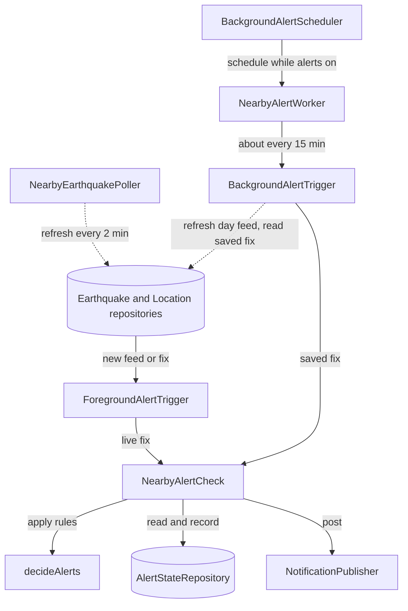
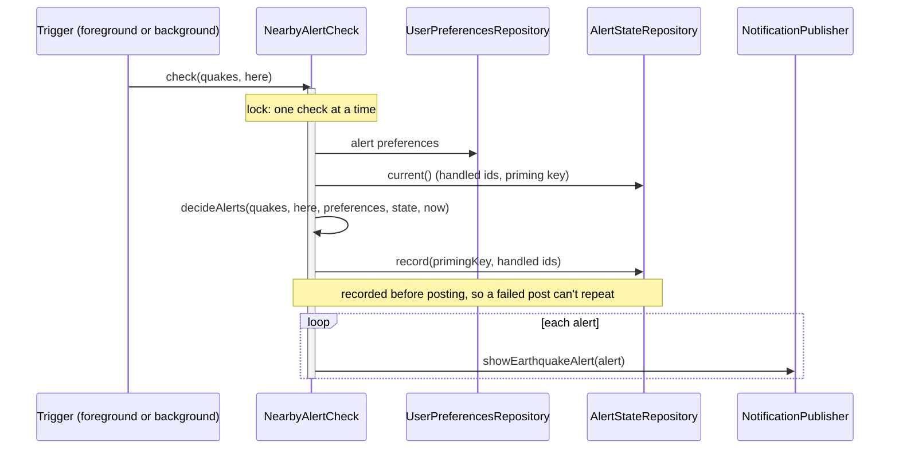
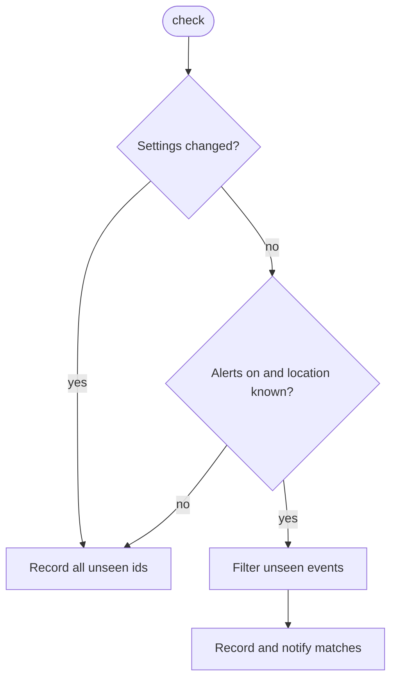

# Alerts

How nearby-earthquake alerts work. There are three jobs, **getting data**, **deciding whether to alert** and **showing the alert**, and two paths (foreground and background) that share one decide-and-show step.

## Overview

Solid arrows are the alert path; dotted arrows only fetch data. The left branch (poller → repositories → `ForegroundAlertTrigger`) runs while the app is visible, the right branch (scheduler → worker → `BackgroundAlertTrigger`) in the background, and both end in the same `NearbyAlertCheck`.

The poller also serves the Map and List screens: they observe the same repositories, so alerts and screens always see the same data.

## Responsibilities

| Class | Job | Depends on |
|---|---|---|
| `NearbyEarthquakePoller` | Foreground fetching: keeps the location and the selected feed fresh while the app is visible. Never alerts. | Repositories, `AppForegroundMonitor` |
| `ForegroundAlertTrigger` | Foreground trigger: runs the check whenever the cached feed or live fix changes. Never fetches. | Repositories, `NearbyAlertCheck` |
| `BackgroundAlertScheduler` | Keeps the WorkManager job registered only while alerts are on. | `UserPreferencesRepository`, `AlertWorkScheduler` |
| `NearbyAlertWorker` | WorkManager entry point; deliberately thin. | `BackgroundAlertTrigger` |
| `BackgroundAlertTrigger` | Background fetch and trigger: refreshes the day feed, reads the saved fix, runs the check. | Repositories, `NearbyAlertCheck` |
| `NearbyAlertCheck` | Decides, records and posts, under one lock so the two paths never post the same event. | `decideAlerts`, `AlertStateRepository`, `NotificationPublisher` |
| `decideAlerts` | The rules, as a pure function. | Nothing Android |
| `NotificationPublisher` / `AndroidNotificationPublisher` | Presentation only: an `EarthquakeAlert` becomes a system notification (channel, permission check, deep link to details). | `NotificationManager` |

## One check, step by step

## The rules (`decideAlerts`)

- **Settings changed** means a different radius or minimum magnitude from the last check, including the very first check.
- **Filter** keeps events at or above the minimum magnitude, within `RECENT_WINDOW` (5 hours) and within the radius.
- **Record all unseen ids** notifies nothing.

- **Priming** stops existing events being replayed after a cold start or a settings change. The key deliberately excludes the location, which changes slightly on every fix, and the feed period, since every alertable event is recent and so appears in every feed.
- **Below-threshold events stay unrecorded,** because USGS often revises automatic magnitudes upward. An event that later crosses the threshold still alerts, once.
- **State is persisted, not held in memory.** A worker usually starts in a fresh process; with in-memory state, every run would look like the first and never alert.

## Foreground vs background

| | Foreground | Background |
|---|---|---|
| Triggered by | New feed or fix (`ForegroundAlertTrigger`) | WorkManager, about every 15 min, or later under Doze or app standby (`NearbyAlertWorker`) |
| Data | Feed for the selected period, refreshed by the poller | Day feed, refreshed by the trigger itself |
| Location | Live coarse fix | Last fix saved while the app was open (cleared if the permission is revoked) |
| Notification | System notification | Same system notification |

Alerts are informational, never an early warning: background timing is whatever Android allows.

## Testing

- `decideAlerts` and `NearbyAlertCheck` are covered through `ForegroundAlertTriggerTest`: radius, window, magnitude, priming, revisions, priming surviving a new process, and no double posting.
- Also covered: `BackgroundAlertTriggerTest`, `BackgroundAlertSchedulerTest` and `NearbyEarthquakePollerTest`.
- Everything above runs on the JVM with fakes. Only `AndroidNotificationPublisher` needs a device (`AndroidNotificationPublisherTest`).
