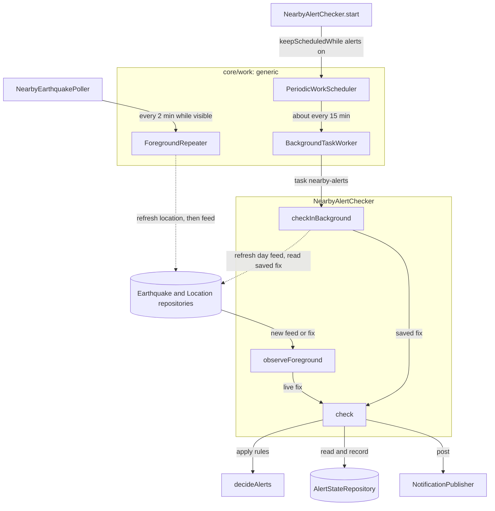
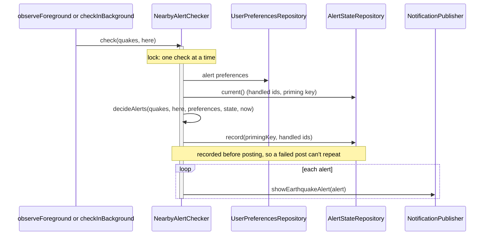

# Alerts

How nearby-earthquake alerts work. There are three jobs, **getting data**, **deciding whether to alert** and **showing the alert**, and two paths (foreground and background) that share one decide-and-show step.

The timing machinery (repeating while the app is open, scheduling with the OS, running work in the background) is generic and lives in `core/work`. This package only says *what* to refresh, *what* to check and *how* to show it.

## Class types

Each class name ends in the kind of thing it is. The generic kinds live in `core/work` and know nothing about earthquakes; the feature kinds live here and use them. Each type you would implement, inject or look up has its own file named after it; a type's small input class or helper extension stays in its file (`PeriodicWork` and `keepScheduledWhile` in `PeriodicWorkScheduler.kt`).

| Kind | Ultimately achieves | Generic (`core/work`) | Alerts (this package) |
|---|---|---|---|
| **Repeater** | Runs work on a timer *inside the app process*, only while the app is visible, so nothing ticks or downloads in the background. | `ForegroundRepeater.repeatWhileForeground(tag, input, interval, action)` | — |
| **Poller** | Decides *what* to keep fresh while the app is open, and hands the timing to the repeater. | — | `NearbyEarthquakePoller`: location, then the selected feed, every 2 min |
| **Scheduler** | Registers work with the *OS*, so it runs even when the app is closed or the process is dead. Survives reboots. | `PeriodicWorkScheduler` (implemented by `WorkManagerPeriodicWorkScheduler`), plus `keepScheduledWhile(flag, work)` to follow a setting | — (the checker declares its `PeriodicWork`) |
| **Task** | One unit of background work as plain Kotlin, so it is testable without WorkManager. Registered by name. | `BackgroundTask` | `"nearby-alerts"` → `NearbyAlertChecker.checkInBackground()`, registered in `AlertsModule` |
| **Worker** | The OS's single entry point into the app: looks up the task by name and runs it. Features never write their own. | `BackgroundTaskWorker` | — |
| **Checker** | The feature logic: decides whether something deserves the user's attention and remembers what it already handled. | — | `NearbyAlertChecker` + the pure rules, `decideAlerts` in `NearbyAlertRules.kt` |
| **Publisher** | Turns a decision into something the user sees. Presentation only. | — | `NotificationPublisher` / `AndroidNotificationPublisher` |

Adding another periodic job takes three steps and no new Android class: implement a `BackgroundTask`, register it with `@IntoMap @StringKey(name)`, and schedule a `PeriodicWork(name, ...)`.

## Overview

Solid arrows are the alert path; dotted arrows only fetch data. The foreground branch (poller → repeater → repositories → `observeForeground`) runs while the app is visible; the background branch (scheduler → worker → `checkInBackground`) runs whenever the OS allows. Both end in the same `check`.

The poller also serves the Map and List screens: they observe the same repositories, so alerts and screens always see the same data.

## Responsibilities

| Class | Job | Depends on |
|---|---|---|
| `NearbyEarthquakePoller` | Keeps the location and the selected feed fresh while the app is visible. Never alerts. | `ForegroundRepeater`, repositories |
| `NearbyAlertChecker` | All alert logic. `start()` begins foreground checks (on every new feed or fix; never fetches) and keeps the background job scheduled only while alerts are on. `checkInBackground()` refreshes the day feed and checks it against the saved fix. Both end in one `check` that decides, records and posts under a lock, so the paths never post the same event. | Repositories, `decideAlerts`, `NotificationPublisher`, `PeriodicWorkScheduler` |
| `decideAlerts` (`NearbyAlertRules.kt`) | The rules, as a pure function. Returns an `AlertDecision`: which ids to record and which alerts to post. | Nothing Android |
| `EarthquakeAlert` | One alert to show: id, magnitude, place, distance. Produced by the rules, shown by the publisher. | — |
| `NotificationPublisher` / `AndroidNotificationPublisher` | An `EarthquakeAlert` becomes a system notification (channel, permission check, deep link to details). | `NotificationManager` |
| `AlertsModule` | Registers `checkInBackground()` as the `nearby-alerts` `BackgroundTask`. | — |

## One check, step by step

## The rules (`decideAlerts`)

- **Settings changed** means a different radius or minimum magnitude from the last check, including the very first check.
- **Filter** keeps events at or above the minimum magnitude, within `RECENT_WINDOW` (5 hours) and within the radius.
- **Record all unseen ids** notifies nothing.

- **Priming** stops existing events being replayed after a cold start or a settings change. The key deliberately excludes the location, which changes slightly on every fix, and the feed period, since every alertable event is recent and so appears in every feed.
- **Below-threshold events stay unrecorded,** because USGS often revises automatic magnitudes upward. An event that later crosses the threshold still alerts, once.
- **State is persisted, not held in memory.** A worker usually starts in a fresh process; with in-memory state, every run would look like the first and never alert.

## Foreground vs background

| | Foreground | Background |
|---|---|---|
| Triggered by | New feed or fix (`observeForeground`) | WorkManager, about every 15 min, or later under Doze or app standby (`BackgroundTaskWorker` → `checkInBackground`) |
| Data | Feed for the selected period, refreshed by the poller | Day feed, refreshed by `checkInBackground` itself |
| Location | Live coarse fix | Last fix saved while the app was open (cleared if the permission is revoked) |
| Notification | System notification | Same system notification |

Alerts are informational, never an early warning: background timing is whatever Android allows.

## Testing

- `decideAlerts` and both entry points are covered through `NearbyAlertCheckerTest`: radius, window, magnitude, priming, revisions, the background day feed and saved fix, priming surviving a new process, and no double posting.
- `NearbyAlertCheckerTest` also covers scheduling: the job follows the alerts toggle, with its 15-minute interval and network constraint.
- `NearbyEarthquakePollerTest` covers the poller and, through it, `ForegroundRepeater` (immediate run, interval, pause in the background, restart on a new period). `PeriodicWorkSchedulerTest` covers `keepScheduledWhile`.
- `BackgroundTaskWorker` and `WorkManagerPeriodicWorkScheduler` are thin WorkManager glue and aren't unit tested; testing them would need `work-testing` and a device or Robolectric.
- Everything above runs on the JVM with fakes. Only `AndroidNotificationPublisher` needs a device (`AndroidNotificationPublisherTest`).
